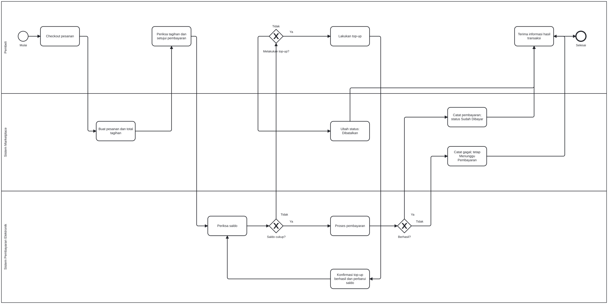

Nama: Fadhil Andriawan

NIM: 053497355

Prodi: Sistem Informasi

Business Process Modelling Notation (BPMN) digunakan untuk menggambarkan langkah-langkah proses bisnis melalui notasi grafis. Standar ini dibuat oleh Business Modeling Initiative Notation Working Group untuk menggambarkan diagram proses bisnis.

Contoh kasus yang akan saya gunakan adalah penelitian Kartini, Malabay, dan Simorangkir (2024) tentang rancangan pembayaran transaksi terpadu berbasis digital. Penelitian tersebut membahas PengusahaX yang memiliki 19 toko dan mengalami ketidaksesuaian antara laporan transaksi dengan perhitungan pemilik. Peneliti mengusulkan pembayaran nontunai serta pencatatan transaksi yang terintegrasi.

Model menggambarkan pembayaran menggunakan saldo elektronik pada sebuah marketplace. Proses dimulai ketika pembeli melakukan checkout dan berakhir ketika pembeli menerima informasi hasil transaksi. Pembeli diasumsikan sudah memiliki akun dan memilih barang yang akan dibeli.

Diagram menggunakan satu proses yang dibagi menjadi tiga lane tanggung jawab, yaitu:
- Pembeli, melakukan checkout, memeriksa tagihan, menyetujui pembayaran, menentukan pengisian saldo, dan menerima informasi hasil transaksi.
- Sistem Marketplace, membuat pesanan dan total tagihan, mencatat hasil pembayaran, serta memperbarui status pesanan.
- Sistem Pembayaran Elektronik, memeriksa saldo, mengonfirmasi keberhasilan top-up, memperbarui saldo, dan memproses pembayaran.

Berikut ini penjelasan terkait alur proses

a. Checkout dan pembuatan tagihan
Proses dimulai ketika pembeli melakukan checkout terhadap barang yang telah dipilih. Sistem marketplace kemudian membuat pesanan dan menghitung total tagihan. Pada tahap ini, pesanan berada dalam status “Menunggu Pembayaran”.

Pembeli memeriksa tagihan tersebut dan memberikan persetujuan pembayaran. Setelah persetujuan diberikan, proses dilanjutkan ke pemeriksaan saldo.

b. Pemeriksaan kecukupan saldo
Sistem pembayaran elektronik memeriksa saldo pembeli dan membandingkannya dengan total tagihan. Hasil pemeriksaan diarahkan melalui exclusive gateway “Saldo cukup?”.

Jika saldo mencukupi, sistem melanjutkan proses pembayaran.
Jika saldo belum mencukupi, maka pembeli menentukan apakah akan melakukan top-up atau membatalkan transaksi.

c. Top-up atau pembatalan
Apabila memilih melakukan top-up, pembeli mengisi saldo melalui pembayaran yang tersedia. Sistem pembayaran elektronik mengonfirmasi keberhasilan top-up terlebih dahulu, kemudian memperbarui saldo pembeli.

Proses selanjutnya kembali ke aktivitas “Periksa saldo”. Pengulangan ini memastikan bahwa saldo setelah top-up sudah mencukupi untuk membayar tagihan. Dengan demikian, top-up dan pembayaran pesanan diperlakukan sebagai dua aktivitas yang berbeda.

Apabila pembeli tidak memilih top-up, transaksi dibatalkan. Sistem marketplace mengubah status pesanan menjadi “Dibatalkan”, kemudian pembeli menerima informasi pembatalan dan proses berakhir.

d. Pemrosesan pembayaran
Jika saldo mencukupi, sistem pembayaran elektronik memproses pembayaran. Hasilnya diperiksa melalui exclusive gateway “Berhasil?”.

Jika berhasil, pembayaran dicatat dan status pesanan diubah menjadi “Sudah Dibayar”.
Jika gagal, marketplace mencatat kegagalan tersebut dan status pesanan tetap “Menunggu Pembayaran”.

Pada jalur berhasil, pembayaran menggunakan saldo pembeli sesuai nominal tagihan. Pada jalur gagal, pesanan belum dianggap lunas. Jalur kegagalan dan pembatalan merupakan pengembangan dalam rancangan tugas ini.

e. Pemberitahuan hasil transaksi
Pembeli menerima informasi hasil transaksi ketika pembayaran berhasil, pembayaran gagal, maupun pembatalan. Setelah informasi tersebut diterima maka proses berakhir.

Apabila pembayaran gagal dan pembeli ingin mencoba kembali, percobaan berikutnya dianggap sebagai proses baru yang berada di luar cakupan diagram ini. 

Diagram BPMN dan Notasi yang Digunakan: 

Diagram menggunakan notasi berikut:

- Start event, berupa lingkaran untuk menandai awal proses.
- Task, berupa kotak bersudut membulat untuk menunjukkan aktivitas, seperti checkout, pemeriksaan saldo, dan pemrosesan pembayaran.
- Exclusive gateway, berupa belah ketupat bertanda X untuk menentukan satu jalur berdasarkan kondisi. Dalam diagram, keputusan yang digunakan adalah “Saldo cukup?”, “Melakukan top-up?”, dan “Berhasil?”.
- Sequence flow, berupa garis berpanah untuk menunjukkan urutan aktivitas, termasuk perpindahan tanggung jawab antar-lane dalam proses yang sama.
- Lane, berupa jalur yang mengelompokkan aktivitas berdasarkan pihak yang bertanggung jawab.
- End event, berupa lingkaran bergaris tebal untuk menandai akhir proses.

Diagram ini dibuat menggunakan tools dari https://demo.bpmn.io/ .

Model BPMN pembayaran elektronik ini memperlihatkan pembagian tanggung jawab antara pembeli, sistem marketplace, dan sistem pembayaran elektronik. Pemeriksaan saldo menjadi keputusan awal sebelum pembayaran diproses. Jika saldo kurang, pembeli dapat melakukan top-up atau membatalkan transaksi.

Sumber referensi:
- BMP MSIM4311 Modul 6
- Kartini, Malabay, & Simorangkir, H. (2024). Memodelkan proses bisnis pembayaran transaksi terpadu berbasis digital. Jurnal Ilmu Komputer dan Sistem Informasi (JIKOMSI), 7(1), 116–125. https://doi.org/10.55338/jikomsi.v7i1.2766