Nama: Fadhil Andriawan

NIM: 053497355

Program Studi: Sistem Informasi

Tugas 1 Sistem Informasi Perencanaan

Sistem operasi: Fedora Linux

1. Tujuan pengolahan data

Pengolahan ini bertujuan menyiapkan data elevasi dan batas administrasi untuk analisis kemiringan lereng (slope) serta arah hadap lereng (aspect) menggunakan QGIS. Wilayah yang digunakan adalah Tangerang Selatan, sesuai data batas administrasi yang dimasukkan. Hasil pengolahan disajikan dalam layout peta agar pola keruangan dapat dibaca bersama legenda, koordinat, dan skala.

Data yang digunakan meliputi raster DEMNAS DEMNAS_1209-41_v1.0.tif dari Badan Informasi Geospasial dan shapefile ADMINISTRASIDESA_AR_25K.shp. DEM menyimpan nilai elevasi pada setiap sel raster, sedangkan shapefile batas administrasi digunakan untuk menentukan batas wilayah pengolahan.

2. Instalasi QGIS

Pada Fedora Linux, saya menginstal QGIS melalui Flatpak dengan repositori Flathub. Perintah yang digunakan adalah:

flatpak install flathub org.qgis.qgis
QGIS digunakan untuk membuka raster elevasi dan data vektor, memotong raster berdasarkan batas administrasi, mengolah informasi lereng, serta membuat layout peta. Setelah instalasi, aplikasi dibuka untuk menyiapkan proyek pengolahan data.

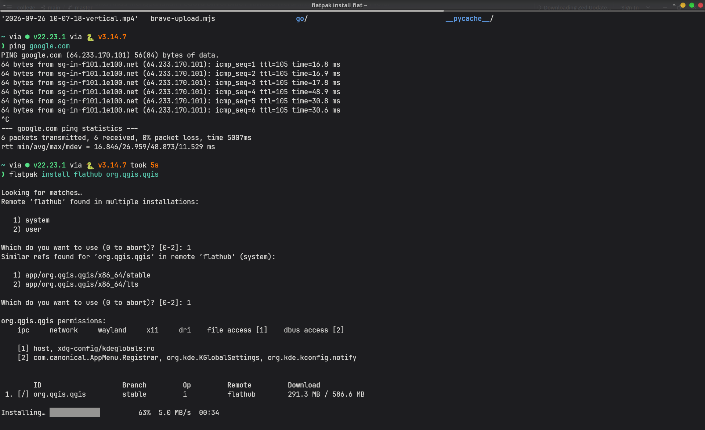

3. Pendaftaran akun dan pengunduhan DEM

Saya melakukan pendaftaran akun pada portal penyedia data agar dapat mengakses unduhan DEMNAS.

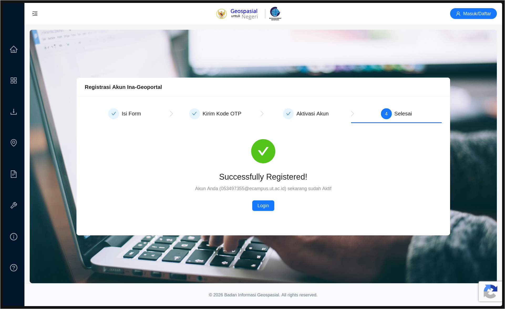

Selanjutnya, saya mengunduh data melalui https://tanahair.indonesia.go.id/portal-web/unduh. Berkas yang digunakan adalah DEMNAS_1209-41_v1.0.tif. Data ini menjadi masukan untuk pengolahan medan karena memuat informasi elevasi dalam bentuk raster.

Pemilihan tile perlu memperhatikan cakupan wilayah kajian. Jika satu tile tidak mencakup seluruh batas administrasi, tile yang bersebelahan perlu ditambahkan dan digabungkan terlebih dahulu. Pemotongan raster tidak dapat menghasilkan informasi elevasi untuk wilayah di luar cakupan data sumber.

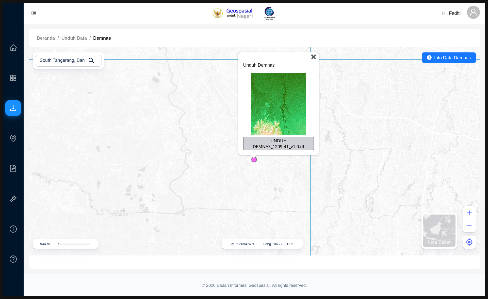

4. Pengunduhan batas administrasi

Karena situs sumber data SHP yang semula dituju tidak dapat diakses, saya menggunakan sumber alternatif berikut:

https://www.indonesia-geospasial.com/2020/01/shp-rbi-provinsi-banten-perwilayah.html

Dari data tersebut, saya menggunakan berkas ADMINISTRASIDESA_AR_25K.shp untuk wilayah Tangerang Selatan. Layer ini berisi poligon batas administrasi yang digunakan sebagai mask saat memotong DEM. Shapefile perlu disimpan bersama berkas pendukungnya, seperti .shx, .dbf, dan .prj apabila tersedia, agar geometri, atribut, dan informasi sistem koordinat dapat dibaca dengan benar.

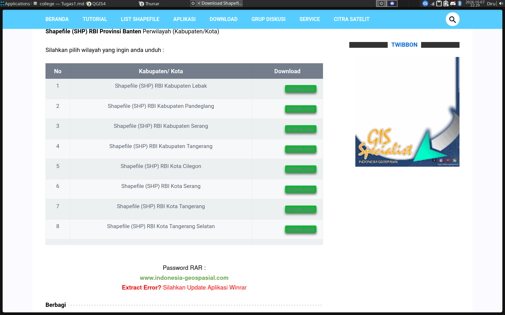

5. Memasukkan raster DEM ke QGIS

Saya membuka QGIS, kemudian menambahkan raster DEM yang sudah diunduh. Pada tahap ini, raster ditampilkan dalam gradasi abu-abu sehingga perbedaan nilai elevasi dapat diamati secara awal.

Tampilan abu-abu merupakan simbologi raster, bukan hasil analisis slope atau aspect. Sebelum pengolahan, lokasi raster, cakupan data, dan sistem koordinatnya perlu diperiksa agar sesuai dengan wilayah kajian.

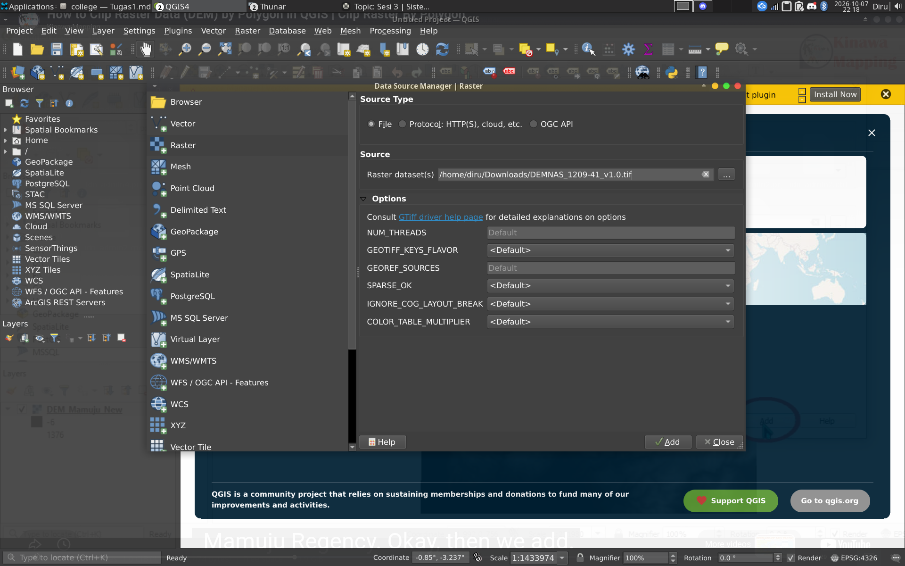

6. Memasukkan vektor batas administrasi

Selanjutnya, saya memasukkan shapefile ADMINISTRASIDESA_AR_25K.shp melalui Data Source Manager pada bagian Vector. Layer vektor ditumpangkan di atas raster untuk memeriksa posisi batas administrasi terhadap cakupan DEM.

Batas administrasi berfungsi membatasi wilayah pengolahan. Pemeriksaan tumpang tindih penting karena DEM dan batas administrasi harus berada pada lokasi geografis yang sesuai. Pada screenshot, CRS proyek yang ditampilkan adalah EPSG:4326. CRS proyek tidak dengan sendirinya membuktikan CRS setiap layer atau CRS yang dipakai untuk perhitungan lereng.

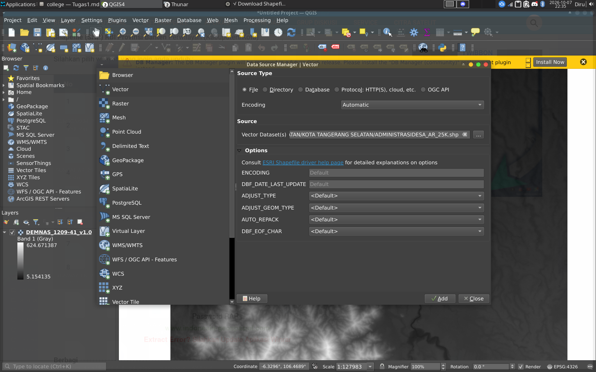

7. Memotong DEM berdasarkan batas administrasi

Saya menggunakan menu Raster Extraction dengan alat Clip Raster by Mask Layer. Raster masukan adalah DEMNAS_1209-41_v1.0, sedangkan mask yang digunakan adalah ADMINISTRASIDESA_AR_25K.

Pemotongan ini mempertahankan bagian raster yang berada di dalam batas mask dan mengeluarkan area di luarnya dari hasil pengolahan. Jika terdapat bagian mask di luar cakupan DEM, bagian tersebut tetap tidak memiliki data elevasi. Karena itu, luas hasil clip bergantung pada irisan cakupan raster dan batas administrasi.

Operasi clip hanya membatasi wilayah raster. Operasi tersebut belum menghitung kemiringan atau arah lereng.

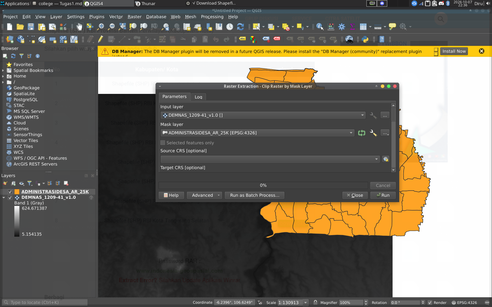

Hasil pemotongan ditambahkan ke proyek sebagai layer tugas1. Raster hasil ini menjadi dasar untuk pengolahan berikutnya.

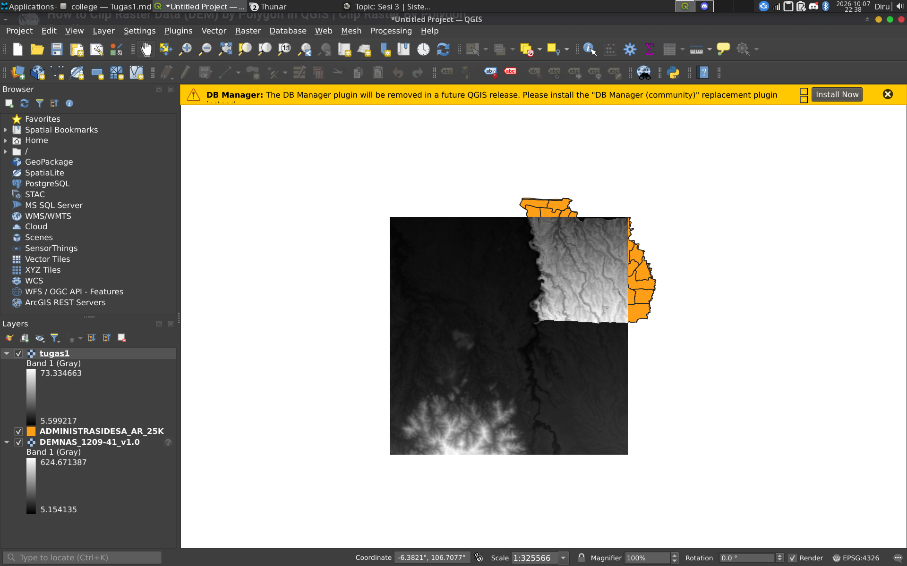

8. Pengaturan simbologi

Saya mengubah simbologi raster menggunakan Singleband pseudocolor agar variasi nilainya lebih mudah dibedakan melalui warna. Pada screenshot, rentang minimum dan maksimum yang diatur untuk layer tugas1 adalah 0–70.

Pengaturan warna hanya mengubah cara data ditampilkan, bukan menghitung slope atau aspect. Oleh karena itu, legenda harus mengikuti jenis raster yang sebenarnya dipetakan. Raster elevasi diberi keterangan elevasi dan satuannya, raster slope diberi satuan derajat atau persen, sedangkan raster aspect diberi keterangan arah lereng.

Rentang 0–70 pada layer tugas1 tidak boleh langsung disebut sebagai kemiringan 0–70° tanpa memastikan sumber layer tersebut. Nilai maksimum tampilan juga perlu diperiksa agar seluruh rentang data yang relevan terwakili.

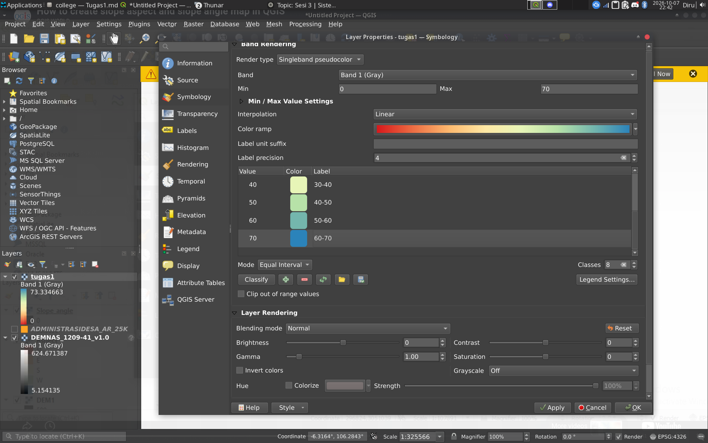

9. Pembuatan print layout

Setelah mengatur tampilan peta, saya membuat print layout dengan nama Slope_Aspect. Layout digunakan untuk menyusun peta beserta elemen pendukungnya pada halaman keluaran.

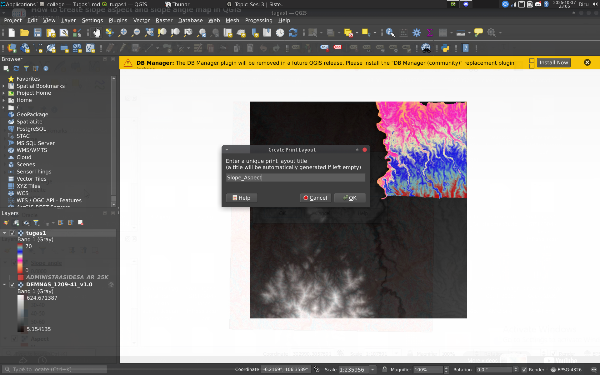

Saya menambahkan item peta ke halaman layout. Item ini menampilkan layer yang dipilih pada proyek QGIS, sehingga layer aktif perlu diperiksa sebelum ekspor agar peta menampilkan variabel yang dimaksud.

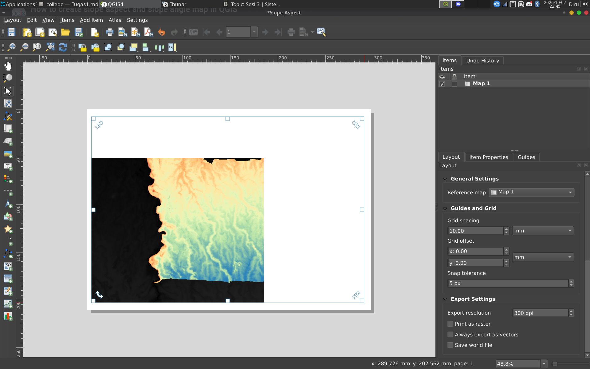

Selanjutnya, saya menyesuaikan halaman, grid koordinat, dan tampilan peta. Grid membantu pembaca mengenali posisi geografis, sedangkan skala batang membantu memperkirakan jarak pada peta.

Agar hasil mudah dibaca, layout sebaiknya memuat judul yang menyebut variabel dan wilayah, legenda dengan satuan yang benar, skala, arah utara, sumber data, serta identitas penyusun. Untuk menyajikan slope dan aspect, dua peta atau dua panel dengan legenda masing-masing lebih jelas daripada satu peta yang tidak membedakan kedua variabel.

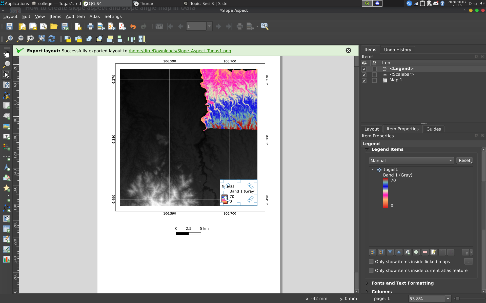

10. Hasil akhir dan batas interpretasi

Berikut merupakan layout yang telah dibuat.

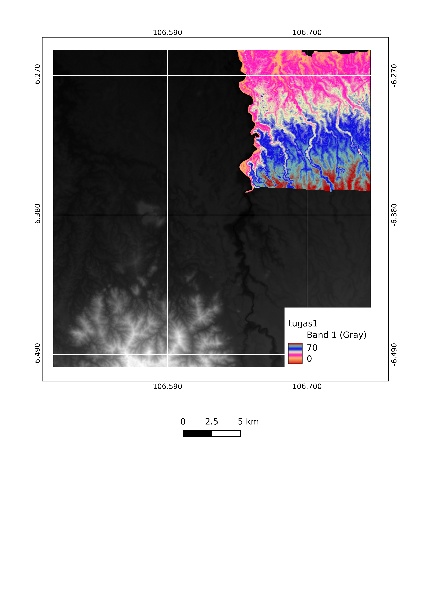

Peta menampilkan latar raster abu-abu dan raster berwarna pada sebagian cakupan peta. Grid koordinat dan skala batang sudah ditambahkan. Namun, legenda raster berwarna masih menggunakan nama tugas1 dan keterangan Band 1 (Gray), sehingga variabel serta satuannya belum dapat dikenali secara jelas oleh pembaca.

Karena itu, peta ini belum cukup untuk menyimpulkan lokasi lereng curam atau arah hadap lereng tertentu. Interpretasi tersebut baru dapat diberikan setelah layer hasil analisis dipastikan dan legenda diperbaiki. Bagian yang tidak tercakup raster berwarna juga perlu diperiksa untuk membedakan area di luar batas kajian, NoData, dan keterbatasan cakupan DEM.

11. Kesimpulan

Pengolahan data dilakukan melalui instalasi QGIS, pengunduhan DEMNAS dan batas administrasi, penambahan raster dan vektor, pemotongan DEM menggunakan mask, pengaturan simbologi, serta pembuatan layout peta. Proyek juga memperlihatkan layer bernama Slope angle dan Aspect, tetapi parameter perhitungannya belum terdokumentasi pada screenshot yang disertakan.

Agar laporan memenuhi tujuan analisis slope dan aspect, hasil kedua analisis perlu ditampilkan dengan identitas layer, satuan, dan legenda yang jelas. Dengan demikian, pembaca dapat membedakan data elevasi, kemiringan, dan arah lereng serta memahami batas cakupan hasil pengolahan.

Sumber referensi
- QGIS. Halaman unduhan QGIS: https://www2.qgis.org/en/site/forusers/alldownloads.html
- Badan Informasi Geospasial. Portal unduhan DEMNAS: https://tanahair.indonesia.go.id/portal-web/unduh
- Indonesia Geospasial. SHP RBI Provinsi Banten per wilayah: https://www.indonesia-geospasial.com/2020/01/shp-rbi-provinsi-banten-perwilayah.html
